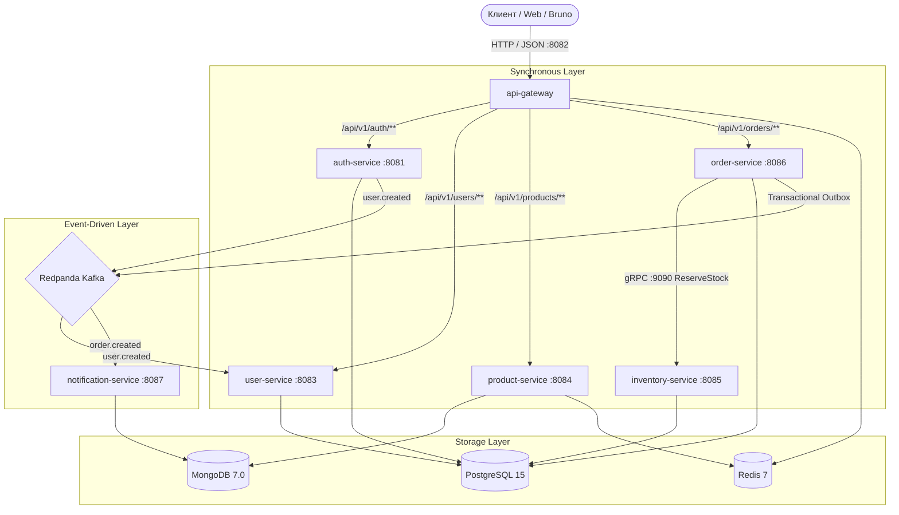

# Event-Driven Order Processing Platform (E-COMMERCE-SHOP)

Высоконагруженная микросервисная платформа, построенная на базе событийной архитектуры (Event-Driven Architecture), 
распределенных транзакций (SAGA), синхронных вызовов gRPC и развертывания в Kubernetes.

---

## Архитектура системы

В основе платформы лежит разделение ответственности по доменным областям (Domain-Driven Design) с гибридным межсервисным взаимодействием:
* **Синхронное взаимодействие (gRPC / HTTP/2):** Ультрабыстрые бинарные вызовы для критичных ко времени операций (проверка и резервация складских остатков между `order-service` и `inventory-service`).
* **Асинхронное взаимодействие (Apache Kafka + Avro + Schema Registry):** Гарантированная публикация событий жизненного цикла заказов (`order.created`, `order.status-changed`, `inventory.reserved`) с использованием паттерна **Transactional Outbox**.
* **Единая точка входа (API Gateway):** Реактивный маршрутизатор на базе Spring Cloud Gateway (WebFlux / Netty) с централизованной валидацией JWT токенов, защитой от несанкционированного доступа и защитой от DDoS через Redis Rate Limiter (алгоритм Token Bucket: 10/20 req/s).



---

## Микросервисы и карта портов

| Модуль / Сервис      | Внутренний порт |   Хост-порт   | Технологии                        | Назначение и функционал |
|:---------------------|:---------------:|:-------------:|:----------------------------------| :--- |
| api-gateway          |     `8082`      |    `8082`     | Spring Cloud Gateway, Redis, JWT  | Единая точка входа, валидация JWT, инъекция заголовков `X-User-Id`, Rate Limitting |
| auth-service         |     `8081`      |    `8081`     | Spring Security 6, JJWT, Postgres | Аутентификация, выдача Access/Refresh токенов, публикация `user.created` в Kafka |
| user-service         |     `8083`      |    `8083`     | JPA, Postgres, Kafka Avro         | Профили пользователей, адреса доставки, идемпотентный Consumer (`processed_events`) |
| product-service      |     `8084`      |    `8084`     | Spring Data MongoDB, Redis        | Каталог товаров, составные индексы, полнотекстовый поиск, кэш Cache-Aside |
| inventory-service    |  `8085`/`9090`  | `8085`/`9090` | JPA, Postgres, gRPC, Redlock      | Учет остатков (SKU), защита от Race Conditions, gRPC сервер |
| order-service        |     `8086`      |    `8086`     | JPA, Postgres, Kafka, gRPC         | Управление заказами, SAGA оркестрация, паттерн Transactional Outbox |
| notification-service |     `8087`      |    `8087`     | MongoDB, Kafka, Redis         | Асинхронные уведомления, аудит сообщений в Mongo, Leaky Bucket, DLQ |
| Redpanda Console     |     `8080`      |    `8080`     | Console Web UI         | Веб-интерфейс для мониторинга топиков Kafka, сообщений и Schema Registry |
| PostgreSQL           |     `5432`      |    `5432`     | PostgreSQL 15         | Реляционные базы данных (auth_db, user_db, inventory_db, order_db) |
| MongoDB              |     `27017`     |    `27017`    | MongoDB 7.0         | Документные БД (product_db, notification_db) |
| Redis                |     `6379`      |    `6379`     | Redis 7 Alpine         | Распределенный кэш, Token Bucket Rate Limiting, распределенные блокировки |
| Kafka Broker         |     `9092`      |    `19092`    | Redpanda v24.1         | Высокопроизводительный C++ брокер сообщений (Kafka v2/v3 compatible) |
| Schema Registry      |     `8061`      |    `18081`    | Confluent Compatible         | Централизованный реестр Avro-схем |

---

## Технологический стек

* **Среда и языка:** Java 21 (Eclipse Temurin JRE Alpine), Gradle (Kotlin DSL, Version Catalogs `libs.versions.toml`),
* **Фреймворк:** Spring Boot 3.3.4, Spring Cloud 2023.0.3, Spring Security 6
* **Базы данных и миграции:** PostgreSQL 15, MongoDB 7.0, Redis 7 Alpine
* **Брокер сообщений и сериализации:** Redpanda Kafka, Apache Avro, Google Protobuf / gRPC
* **Инфраструктура и оркестрация:** Docker, Kubernetes, Helm, GitHub Actions CI

---

## Быстрый старт

1. ### Предварительное требование

   * Java 21 (JDK)
   * Docker
   * Утилита make

2. ### Подготовка переменных окружения и секретов

    Секреты локального dev-окружения изолированы в директории `.secrets/dev/`. Скопируйте шаблон:
    ```bash
    cp .secrets/dev/.env.example .secrets/dev/.env
    ```

3. ### Запуск платформы
   
   **Вариант А:** Запуск всего стека одной командой
   Сборка JAR-артефактов через Gradle, сборка Docker-образов и запуск всех контейнеров с ожиданием готовности
   
   ```bash
   make dev-up
   ```
   **Вариант Б:** Запуск только инфраструктуры (Для локальной разработки и отладки)
   Если хотите отлаживать и проверять микросервисы локально
   
   ```bash
   make dev-infra
   ```

4. ### Управление и команды Makefile
| Команда        | Описание |
|:---------------|:--|
| make dev-up    |  Собрать JAR и запустить полный стек (инфраструктура + все микросервисы) |
| make dev-infra |  Запустить только базы данных, Redis и брокер Kafka |
| make dev-logs  |  Просмотр логов всех контейнеров в реальном времени (`docker compose logs -f`) |
| make dev-down  |  Корректная остановка контейнеров платформы |
| make dev-clean |  Полная остановка с очисткой Docker томов (Volumes) и сбросом данных |
| make build     |  Полная компиляция и сборка модулей через Gradle (`./gradlew build`) |
| make test      |  Прогон тестов всех модулей (`./gradlew test`) |

---

## Развертывание в Kubernetes (k3d & Helm)

1. ### Создание локального кластера (1 Server + 2 Worker Nodes с пробросом Ingress):
   
   ```bash
   make k3d-up
   ```
   
2. ### Внедрение dev-секретов в кластер (неймспейс ecommerce):

   ```bash
   make inject-secrets
   ```

3. ### Деплой сервисов через общий Helm-чарт:

   ```bash
   helm upgrade --install ecommerce-auth-service helm/ecommerce-common -f helm/environments/auth-service.yaml -n ecommerce
   ```

4. ### Удаление кластера:

   ```bash
   make k3d-down
   ```

---

## Проверка работоспособности

* **Redpanda Console (Kafka UI):** http://127.0.0.1:8080
* **Swagger/OpenAPI документация:**
   * **Auth Service:** http://127.0.0.1:8081/swagger-ui.html
   * **и другие по тому же принципу**
* **Маршруты API Gateway (:8082)**
   * `/api/v1/auth/**` --> `auth-service`
   * `/api/v1/users/**` --> `user-service`
   * `/api/v1/products/**` --> `product-service`
   * `/api/v1/orders/**` --> `order-service`
* **Коллекция HTTP-запросов:** В директории `/api-requests-bruno/` подготовлены готовые сценарии тестирования в формате Bruno GUI для каждого микросервиса 


    
